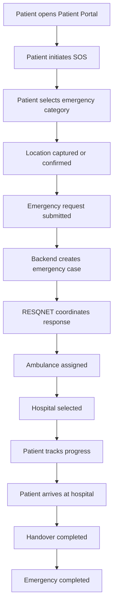

# RAAH — Patient Portal

**Document Status:** Draft for Team Approval
**Version:** 1.0
**Project:** RAAH
**Last Updated:** 24 November 2026

---

## 1. Purpose

The Patient Portal is the patient-facing interface of RAAH.

It allows patients to request emergency assistance, share their location and essential medical information, monitor ambulance coordination and view their designated hospital.

The portal communicates with the shared RAAH backend, which coordinates with the Ambulance Driver, Hospital Staff and Admin / Control Centre portals.

The Patient Portal must be responsive and accessible across mobile phones, tablets and desktop devices.

## 2. Portal Objectives

The Patient Portal aims to:

1. Provide a simple method for requesting emergency assistance.
2. Reduce delays in emergency response through location sharing.
3. Provide access to essential patient identification and medical information.
4. Allow patients to monitor emergency progress.
5. Display assigned ambulance and hospital information.
6. Provide secure access to patient emergency records.
7. Support the Cura Card patient identification system.

## 3. User Roles

### 3.1 Patient

A registered patient can:

- Manage their profile.
- Store essential medical information.
- Create emergency requests.
- Share location.
- View their emergency status.
- View assigned ambulance and hospital information.
- Access their Cura Card.
- View their permitted medical records.

### 3.2 Unauthenticated Emergency User

The team must determine whether RAAH will permit a limited emergency request without a pre-existing patient account.

If supported, the system must define identity verification, patient-record creation and subsequent account linking.

**Status:** Pending product and security decision.

## 4. Portal Navigation

Proposed main navigation:

1. Dashboard
2. Emergency Assistance
3. Hospital Information
4. Ambulance Tracking
5. Medical Information
6. Cura Card
7. Emergency Contacts
8. Emergency History
9. Profile and Settings

The MVP may use a reduced navigation structure.

## 5. Functional Requirements

### 5.1 Registration and Authentication

**Priority:** MVP

The portal should provide:

- Patient registration.
- Mobile number verification.
- OTP-based login, subject to the selected authentication implementation.
- Optional email association.
- Secure session handling.
- Logout.
- Account recovery.

The backend must authenticate the patient and enforce access restrictions.

### 5.2 Patient Dashboard

**Priority:** MVP

The dashboard should display:

- Patient profile summary.
- Emergency assistance entry point.
- Active emergency status.
- Assigned ambulance information when available.
- Hospital information when available.
- Essential medical information.
- Relevant notifications.

The dashboard must clearly distinguish between an active emergency and normal account information.

### 5.3 Patient Profile

**Priority:** MVP

Patient profile information may include:

- Full name.
- Date of birth.
- Contact number.
- Email address.
- Address.
- Emergency contact details.

Patients should be able to update permitted profile fields.

Sensitive changes must follow appropriate verification and validation.

### 5.4 Emergency Medical Information

**Priority:** MVP

Patients should be able to store essential emergency information, including:

- Blood group.
- Known allergies.
- Existing medical conditions.
- Current medications.
- Relevant medical notes.
- Other critical emergency information.

The system must validate the information and restrict access to authorised users.

A medical information record must not be assumed to be clinically verified merely because a patient entered it.

### 5.5 Emergency Assistance / SOS

**Priority:** MVP

The SOS interface must be simple and usable under stressful conditions.

It should allow the patient to:

- Initiate an emergency request.
- Select an emergency category.
- Provide a short description.
- Share their location.
- Confirm or manually correct their location.
- Submit the request.

Proposed emergency categories:

- Cardiac emergency.
- Accident or trauma.
- Breathing difficulty.
- Stroke.
- Pregnancy-related emergency.
- Other.
- Unsure.

The final category vocabulary must match the backend contract.

After submission, the portal should display backend-confirmed request receipt and the emergency reference.

The frontend must not display an emergency as successfully registered until the backend confirms creation.

### 5.6 Location Sharing

**Priority:** MVP

The portal should:

- Request device location permission.
- Capture available GPS coordinates.
- Display the detected location.
- Allow manual location correction.
- Associate the location with the emergency request.
- Communicate location-sharing failures.
- Display the last confirmed location where relevant.

The application must not silently substitute an inaccurate location.

### 5.7 Emergency Status Tracking

**Priority:** MVP

The patient should be able to view the progress of their active emergency.

Proposed patient-facing stages:

1. Emergency request received.
2. Emergency under coordination.
3. Ambulance assigned.
4. Ambulance travelling to patient.
5. Ambulance arrived at pickup location.
6. Patient onboard.
7. Travelling to hospital.
8. Arrived at hospital.
9. Patient handover.
10. Emergency completed.

These are display stages, not a new backend status enum.

The final mapping must be documented in `../02-backend/STATUS_MAPPING.md`.

The portal must display meaningful error and delayed-update states.

### 5.8 Hospital Recommendation and Information

**Priority:** MVP

Once a hospital has been selected, the patient should be able to view:

- Hospital name.
- Address.
- Contact information.
- Relevant department or emergency capability.
- Distance where available.
- Estimated arrival information where supported.
- Hospital readiness or acknowledgement where available.

Patients should not independently select an unsuitable destination outside the authorised coordination workflow.

### 5.9 Ambulance Tracking

**Priority:** MVP dependency

The portal should display:

- Ambulance identification.
- Driver information permitted for patient access.
- Ambulance location.
- Estimated arrival information where supported.
- Last location update.
- Location freshness state.

Location data must not be represented as live if updates are unavailable or stale.

### 5.10 Cura Card

**Priority:** MVP, subject to final security design

The Cura Card is RAAH's patient identification card.

Its intended purpose is to help identify a patient quickly during an emergency and provide access to authorised emergency information.

Proposed functionality:

- Generate a unique patient-linked QR identifier.
- Display the Cura Card.
- Allow the patient to view or download the card.
- Support QR validation through the backend.
- Allow revocation or regeneration where supported.

**Security requirements:**

- Do not encode unrestricted medical information directly into a publicly readable QR code.
- Use a secure identifier or token.
- Validate QR access through the backend.
- Enforce authorisation.
- Record sensitive access.
- Apply appropriate expiry, revocation and emergency-access rules.

The exact Cura Card data model and access mechanism require confirmation before implementation.

### 5.11 Emergency Contacts

**Priority:** Post-MVP

Patients should be able to:

- Add emergency contacts.
- Edit contact details.
- Remove contacts.
- Identify primary contacts.
- Manage contact preferences.

### 5.12 Medical Records

**Priority:** Post-MVP

Possible functionality:

- View medical records.
- Upload supporting documents.
- View relevant medical history.
- Manage permitted data-sharing preferences.
- Review authorised access where supported.

### 5.13 Emergency History

**Priority:** Post-MVP

The patient should eventually be able to view:

- Previous emergency requests.
- Emergency dates.
- Emergency reference numbers.
- Final status.
- Relevant permitted details.

### 5.14 Notifications

**Priority:** MVP basic notifications

The portal should display relevant updates, such as:

- Emergency request received.
- Ambulance assigned.
- Ambulance approaching.
- Hospital selected.
- Hospital arrival.
- Handover completion.

The actual notification channels depend on implemented backend infrastructure.

### 5.15 Account and Privacy Settings

**Priority:** MVP basic settings; advanced controls post-MVP

Possible settings include:

- Profile preferences.
- Account security.
- Contact preferences.
- Medical information access.
- Privacy information.
- Account deactivation or deletion requests.

## 6. Emergency Workflow

The backend determines the authoritative operational status throughout this workflow.

## 7. Backend Integration Requirements

The following are functional API requirements. Endpoints marked as verified reflect implemented and tested backend services.

| Feature | Backend responsibility | Verification Status |
|---|---|---|
| Registration/login | Authenticate patient | Open (deferred to M8) |
| Profile | Retrieve and update authorised patient data | To verify |
| SOS | Create emergency | Verified (`POST /api/v1/emergencies`) |
| Emergency details | Retrieve patient-owned emergency | Verified (`GET /api/v1/emergencies/:id`) |
| Location | Store and retrieve permitted location data | Verified |
| Status | Retrieve authoritative emergency status | Verified (`PATCH /api/v1/emergencies/:id/status`) |
| Ambulance Recommendation | Evaluate and rank suitable ambulance candidates | Verified (`GET /api/v1/emergencies/:id/ambulance-recommendations`, M5.3 Stage 2) |
| Ambulance | Retrieve relevant assignment and ambulance information | Verified |
| Hospital Recommendation | Evaluate and rank hospital suitability using resource and capability matching | Verified (`GET /api/v1/emergencies/:id/hospital-recommendations`, M5.3 Stage 2) |
| Destination Selection | Validate and record selected hospital destination with hard operational safety blocks and concurrency protection | Verified (`PATCH /api/v1/emergencies/:id/destination`, M5.3 Stage 2) |
| Hospital | Retrieve selected hospital information | Verified |
| Medical information | Securely retrieve and update medical details | To verify |
| Cura Card | Generate and validate secure patient identifier | Concept / Pending security design |
| History | Retrieve permitted previous emergencies | To verify |
| Notifications | Retrieve and acknowledge relevant notifications | To verify |

> [!NOTE]
> **Allocation & Destination Selection Operational Limitations:**
> - Recommendation endpoints are strictly read-only decision support with zero database side effects.
> - Destination selection records operational intent and does not guarantee hospital intake, clinical bed availability, or triage acceptance.
> - CLOSED and DIVERTING hospitals, as well as depleted/incompatible required resources, are hard operational blocks (non-overridable).
> - Overrides on review-flagged hospitals require a meaningful explanation (>= 10 characters).
> - Hospital distance calculation uses straight-line distance from incident coordinates, not live ambulance GPS en route.
> - Concurrency protection is implemented via optimistic conditional updates (`updateMany`), verified by unit tests; real-world multi-connection database stress tests remain pending.
> - Authentication and authorization are deferred to M8 (`actorId` is currently `null`).

Actual endpoint paths, request DTOs, response formats and access controls must be recorded in `../02-backend/API_ENDPOINTS.md` and `../02-backend/API_INTEGRATION_MAP.md`.

## 8. Security and Privacy Requirements

The Patient Portal must:

1. Authenticate patients before exposing protected account information.
2. Enforce patient ownership on emergency and medical records.
3. Protect medical information in transit and at rest.
4. Prevent public exposure of sensitive Cura Card information.
5. Record authorised emergency medical-data access.
6. Communicate consent and emergency-access rules clearly.
7. Prevent unauthorised modification of emergency status.
8. Validate all submitted data.
9. Avoid exposing internal identifiers or operational information unnecessarily.

Emergency medical-data access must follow applicable clinical, privacy and legal requirements.

## 9. Error Handling and Accessibility

The portal should support:

- Clear loading states.
- Network failure handling.
- Emergency submission failure messages.
- Location permission denial.
- GPS unavailable state.
- Stale ambulance location indication.
- Session expiry handling.
- Accessible controls and readable text.
- Responsive layouts.
- Clear emergency instructions.

The SOS interface must prioritise simplicity and avoid unnecessary steps.

## 10. Future Scope

The following capabilities may be considered in later versions:

- Native mobile applications.
- Family and dependent profiles.
- Appointment scheduling.
- Medication reminders.
- Advanced medical record integration.
- OCR for medical documents.
- Voice-based emergency assistance.
- Advanced multilingual support.
- Family-facing emergency tracking.
- Advanced patient analytics.

## 11. MVP Acceptance Criteria

The Patient Portal's MVP is ready when:

- An authorised patient can access the portal.
- A patient can submit an emergency request.
- The backend confirms emergency creation.
- Location information is captured or manually confirmed.
- The patient can retrieve their emergency status.
- The patient can view relevant ambulance information.
- The patient can view the designated hospital.
- Sensitive information is protected by backend authorisation.
- The Cura Card implementation, if included in the MVP release, passes its security requirements.
- Critical failure scenarios are handled clearly.

## 12. Related Documentation

- `../00-project/MVP_SCOPE.md`
- `../00-project/SYSTEM_ARCHITECTURE.md`
- `AMBULANCE_PORTAL.md`
- `HOSPITAL_PORTAL.md`
- `ADMIN_PORTAL.md`
- `../02-backend/API_ENDPOINTS.md`
- `../02-backend/API_INTEGRATION_MAP.md`
- `../02-backend/STATUS_MAPPING.md`
- `../03-workflows/EMERGENCY_LIFECYCLE.md`
