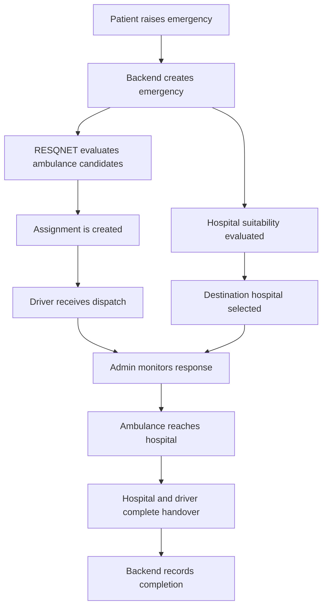

# RAAH — Admin / Control Centre Portal

**Document Status:** Draft for Team Approval
**Version:** 1.0
**Project:** RAAH
**Last Updated:** 24 November 2026

---

## 1. Purpose

The Admin / Control Centre Portal is the central operational management interface of RAAH.

It allows authorised administrators to monitor emergencies, manage ambulance and hospital operations, oversee allocation, coordinate emergency response and intervene when automated processes cannot proceed.

The portal is connected to the shared RAAH backend.

It is separate from the Patient, Ambulance Driver and Hospital Staff portals.

## 2. Portal Objectives

The Admin Portal aims to:

1. Provide a system-wide view of emergency operations.
2. Monitor active emergency cases.
3. Manage ambulance and driver records.
4. Manage hospital records and operational status.
5. Monitor hospital resources and suitability.
6. View allocation recommendations.
7. Execute authorised ambulance assignments.
8. Select or change hospital destinations.
9. Monitor mission progress.
10. Coordinate hospitals and ambulance drivers.
11. Maintain operational history and auditability.

## 3. Admin Account Structure

### 3.1 Super Administrator

**Priority:** MVP

The initial design contains one Super Administrator.

The Super Administrator has full authorised administrative access across the RAAH system.

Responsibilities include:

- Emergency monitoring.
- Ambulance management.
- Driver management.
- Hospital management.
- Allocation oversight.
- Manual intervention.
- Account and registration management.
- System configuration.
- Operational reporting.

Administrative actions must be authenticated, authorised and auditable.

### 3.2 Future Admin Roles

**Priority:** Future

The system may later support specialised roles, such as:

- Emergency Dispatcher.
- Hospital Coordinator.
- Ambulance Coordinator.
- Verification Officer.
- System Administrator.

These roles are not assumed to be part of the initial release.

## 4. Portal Navigation

Proposed sidebar:

1. Dashboard
2. Emergency Control Centre
3. Live Operations Map
4. Ambulance Management
5. Hospital Management
6. Patient Management
7. Resource Allocation
8. Notifications and Alerts
9. Communication Centre
10. Reports and Analytics
11. Emergency History
12. Verification and Registrations
13. System Monitoring
14. Audit Logs
15. Settings

The MVP may use a reduced navigation structure.

## 5. Functional Requirements

### 5.1 Admin Authentication

**Priority:** MVP

The portal must provide:

- Secure administrator login.
- Session management.
- Logout.
- Account recovery.
- Appropriate access restrictions.

The backend must enforce administrative permissions.

### 5.2 Admin Dashboard

**Priority:** MVP

The dashboard should provide an overview of:

- Active emergencies.
- New emergency requests.
- Ambulances available.
- Ambulances assigned.
- Ambulances unavailable.
- Registered hospitals.
- Hospital operational statuses.
- Incoming ambulance missions.
- Pending hospital acknowledgements.
- Critical alerts.
- Recent operational activity.

Counts and status indicators must be retrieved from backend data.

### 5.3 Emergency Control Centre

**Priority:** MVP

The Emergency Control Centre is the primary operational workspace.

It should provide:

- Active emergency list.
- Emergency references.
- Emergency categories.
- Patient references.
- Pickup locations.
- Emergency timestamps.
- Current emergency status.
- Assigned ambulance.
- Destination hospital.
- Relevant operational alerts.

The Admin should be able to open an emergency and inspect its complete authorised operational details.

### 5.4 Emergency Monitoring

**Priority:** MVP

The Admin should be able to monitor emergency progress from request creation through completion.

Monitoring should include:

- Request receipt.
- Allocation progress.
- Ambulance assignment.
- Driver acceptance or rejection.
- Ambulance movement.
- Hospital selection.
- Hospital acknowledgement.
- Patient pickup.
- Hospital arrival.
- Handover.
- Emergency completion.

The backend remains the source of truth.

### 5.5 Ambulance Dispatch and Assignment

**Priority:** MVP

The intended dispatch process is:

1. An emergency is created.
2. RESQNET evaluates ambulance candidates.
3. Suitable candidates are ranked.
4. The backend or authorised Admin selects a candidate.
5. The Assignment service validates and creates the assignment.
6. The driver receives the dispatch.
7. The driver accepts or rejects.
8. Rejected assignments are recorded.
9. Another candidate can be evaluated and assigned.

The Admin should be able to perform manual assignment when automated allocation cannot proceed.

**Architectural rule:** Allocation provides recommendations. Assignment executes and validates the actual assignment.

### 5.6 Hospital Recommendation and Allocation

**Priority:** MVP

The Admin should be able to view suitable hospital candidates based on relevant criteria, such as:

- Emergency category.
- Required specialisation.
- Hospital operational status.
- Resource availability.
- Geographical distance.
- Estimated travel time where supported.
- Relevant emergency capabilities.

The Admin should be able to select a destination through the approved backend workflow.

The system should retain the history of destination selection and changes.

### 5.7 Emergency Intervention and Escalation

**Priority:** MVP

The Admin should be notified when an emergency cannot progress normally.

Potential situations include:

- No suitable ambulance.
- Driver rejection.
- Ambulance failure.
- Hospital inability to accommodate.
- Resource availability changes.
- Missing acknowledgement.
- GPS failure.
- Delayed mission progress.
- Handover exception.

The Admin should be able to perform authorised intervention, including reassignment and destination reassessment.

Every intervention must be validated and recorded.

### 5.8 Live Operations Map

**Priority:** MVP dependency

The map should display relevant operational locations:

- Emergency pickup locations.
- Active ambulances.
- Designated hospitals.
- Relevant destination routes where supported.

Potential filters:

- Active emergencies.
- Available ambulances.
- Assigned ambulances.
- Hospital operational status.
- Emergency category.
- Mission status.

The map must indicate location freshness.

It must not present stale coordinates as live positions.

### 5.9 Ambulance Management

**Priority:** MVP

The Admin should be able to:

- Register ambulances.
- View ambulance details.
- Update permitted vehicle information.
- Manage ambulance operational status.
- View ambulance capabilities.
- View assigned driver information.
- Associate drivers with ambulances.
- Review ambulance assignment history.

Potential ambulance information includes:

- Vehicle identifier.
- Registration number.
- Vehicle type.
- Equipment and capabilities.
- Operational status.
- Assigned driver.
- Relevant maintenance information.

Exact fields must follow the database schema.

### 5.10 Driver Management

**Priority:** MVP

The Admin should be able to:

- Register drivers.
- Review driver information.
- Verify drivers.
- Activate or deactivate accounts.
- Associate drivers with ambulances.
- Review driver availability.
- View active missions.
- Review mission history.

The backend must prevent unauthorised driver-to-ambulance associations.

### 5.11 Hospital Management

**Priority:** MVP

The Admin should be able to:

- Register hospitals.
- Review hospital details.
- Verify hospital information.
- Activate or deactivate hospital access.
- View hospital operational status.
- View hospital resources.
- Review incoming emergency activity.
- View hospital allocation history.

### 5.12 Hospital Capacity Monitoring

**Priority:** MVP essential resources

The Admin should be able to monitor essential hospital capacity information.

Potential categories:

- General beds.
- ICU beds.
- Emergency beds.
- Oxygen.
- Blood availability.
- Relevant medical equipment.

The system must distinguish between hospital-reported availability and independently verified physical capacity.

### 5.13 Hospital Staff and Specialisation Monitoring

**Priority:** Post-MVP

The Admin may eventually view:

- Hospital employee accounts.
- Relevant staff roles.
- Medical specialisations.
- Staff availability.
- Department information.

Access must be limited to administrative necessity.

### 5.14 Hospital Equipment and Resource Monitoring

**Priority:** Post-MVP

Potential capabilities:

- Equipment availability.
- Equipment maintenance status.
- Resource quantities.
- Critical stock alerts.
- Resource update history.

### 5.15 Hospital Readiness and Suitability Evaluation

**Priority:** MVP essential suitability; advanced scoring future

The system should evaluate whether a hospital is appropriate for an emergency.

Potential criteria:

- Operational status.
- Emergency capability.
- Relevant specialisation.
- Resource availability.
- Geographical suitability.
- Travel time where supported.

Suitability must be specific to the emergency.

A hospital that is geographically close is not automatically the most suitable hospital.

The Admin should be able to review the recommendation and intervene when necessary.

### 5.16 Patient and Emergency Request Management

**Priority:** MVP emergency details; full patient administration post-MVP

The Admin should be able to:

- View relevant patient references.
- View active emergency information.
- Monitor patient-related emergency progress.
- Access authorised emergency medical information.
- Review emergency history where permitted.

Patient data access must be restricted and auditable.

### 5.17 Ambulance Mission Monitoring

**Priority:** MVP

The Admin should be able to monitor:

- Assignment status.
- Driver acceptance.
- Ambulance location.
- Pickup progress.
- Patient onboard status.
- Hospital destination.
- Hospital arrival.
- Handover progress.
- Mission completion.

### 5.18 Emergency Communication and Coordination

**Priority:** MVP basic coordination

The Admin should be able to coordinate with:

- Ambulance drivers.
- Hospital staff.
- Relevant emergency stakeholders.

The communication mechanism must be defined by actual backend and external-service capabilities.

### 5.19 Notifications and Alerts

**Priority:** MVP

The Admin should receive alerts for:

- New emergencies.
- Assignment rejection.
- No suitable ambulance.
- Hospital capacity issues.
- Hospital inability to accommodate.
- Ambulance delays.
- GPS unavailability.
- Mission exceptions.
- Pending handover.
- System errors affecting emergency operations.

### 5.20 Reports and Analytics

**Priority:** Post-MVP

Potential reports include:

- Total emergencies.
- Emergency categories.
- Average response times.
- Ambulance utilisation.
- Assignment acceptance and rejection.
- Hospital allocation frequency.
- Hospital response times.
- Handover duration.
- Emergency completion statistics.

Exports and advanced visual analytics are post-MVP unless specifically approved.

### 5.21 Emergency History

**Priority:** MVP essential event history; advanced search post-MVP

The Admin should be able to inspect completed emergency records and relevant event timelines.

The history should support investigation of:

- Assignment changes.
- Destination changes.
- Status transitions.
- Operational interventions.
- Hospital responses.
- Handover completion.

### 5.22 Resource Allocation Monitoring

**Priority:** MVP

The Admin should be able to monitor:

- Available ambulances.
- Assigned ambulances.
- Unavailable ambulances.
- Hospital operational status.
- Relevant hospital resources.
- Allocation recommendations.
- Allocation exceptions.

### 5.23 Verification and Registration Management

**Priority:** MVP supporting operations

The Admin should be able to manage the registration and verification of:

- Hospitals.
- Ambulance drivers.
- Ambulances.

The system should retain verification and activation history.

### 5.24 System Monitoring

**Priority:** MVP basic operational visibility

The portal should provide visibility into important operational failures, such as:

- Backend connectivity problems.
- Failed allocation operations.
- Failed assignment operations.
- Data synchronisation failures.
- External service failures where integrated.

Detailed infrastructure monitoring may remain an engineering responsibility outside the Admin Portal.

### 5.25 Audit Logs

**Priority:** MVP essential audit events

The system should record important administrative actions, including:

- Account creation and modification.
- Hospital changes.
- Ambulance changes.
- Driver verification.
- Manual assignments.
- Destination changes.
- Emergency interventions.
- Patient information access.
- Administrative settings changes.

### 5.26 Admin Settings and Configuration

**Priority:** MVP essential settings; advanced configuration post-MVP

Potential settings:

- Emergency categories.
- Operational configuration.
- Allocation parameters.
- Notification configuration.
- Access-control settings.

Critical allocation and lifecycle settings must not be exposed without validation and appropriate safeguards.

### 5.27 Data Validation and Reliability

**Priority:** MVP

The Admin Portal must:

- Display backend-confirmed data.
- Validate administrative actions.
- Handle concurrent updates.
- Identify stale information.
- Communicate failed operations.
- Prevent invalid state changes.
- Preserve operational history.

### 5.28 Future Geographic and Time Analytics

**Priority:** Future

Potential capabilities:

- Emergency hotspots.
- Response-time patterns.
- Ambulance demand analysis.
- Hospital demand analysis.
- Geographic resource distribution.
- Predictive capacity planning.

### 5.29 Future Administrative Roles

**Priority:** Future

The system may eventually support multiple Admin roles with restricted responsibilities.

The initial implementation remains based on one Super Administrator.

## 6. Operational Workflow

The workflow represents the intended integrated process.

RESQNET performs recommendation logic through the backend. The Assignment service performs the actual assignment. The Admin supervises and intervenes when required.

## 7. Backend Integration Requirements

These are functional requirements, not claims that all endpoints currently exist.

| Feature | Backend responsibility |
|---|---|
| Admin authentication | Authenticate administrator |
| Dashboard | Retrieve system-wide operational data |
| Emergency Control Centre | Retrieve emergency records and events |
| Ambulance management | Create and manage ambulance records |
| Driver management | Manage driver accounts and associations |
| Hospital management | Create and manage hospital records |
| Hospital resources | Retrieve and update resource availability |
| Allocation | Retrieve candidate recommendations |
| Assignment | Create and manage validated assignments |
| Destination selection | Validate and record selected hospital |
| Mission monitoring | Retrieve assignment and emergency progress |
| Live map | Retrieve relevant location data |
| Notifications | Deliver operational alerts |
| History | Retrieve case event history |
| Audit | Record administrative actions |

Exact endpoints, payloads and permissions must be maintained in the backend documentation.

## 8. MVP Acceptance Criteria

The Admin Portal MVP is ready when:

- The Super Administrator can authenticate.
- The dashboard displays backend-confirmed operational data.
- Active emergencies can be monitored.
- Ambulances and drivers can be managed.
- Hospitals and essential resource availability can be managed.
- Ambulance recommendations can be reviewed.
- Validated ambulance assignments can be created.
- Hospital recommendations and destination selection can be managed.
- Mission progress can be monitored.
- Exceptions can be handled through authorised intervention.
- Important actions are recorded.
- Sensitive patient information is protected.

## 9. Related Documentation

- `../00-project/MVP_SCOPE.md`
- `../00-project/SYSTEM_ARCHITECTURE.md`
- `PATIENT_PORTAL.md`
- `AMBULANCE_PORTAL.md`
- `HOSPITAL_PORTAL.md`
- `../02-backend/DATABASE_SCHEMA.md`
- `../02-backend/API_ENDPOINTS.md`
- `../02-backend/STATUS_MAPPING.md`
- `../02-backend/API_INTEGRATION_MAP.md`
- `../03-workflows/EMERGENCY_LIFECYCLE.md`
