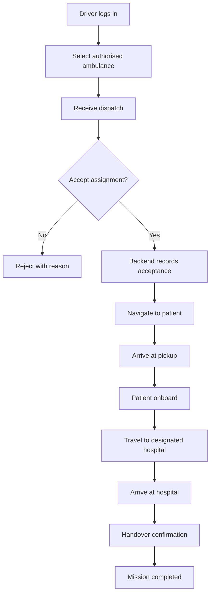

# RAAH — Ambulance Driver Portal

**Document Status:** Draft for Team Approval
**Version:** 1.0
**Project:** RAAH
**Last Updated:** 24 November 2026

---

## 1. Purpose

The Ambulance Driver Portal is the operational interface used by authorised ambulance drivers to receive emergency dispatches, manage missions, share location and coordinate patient transportation.

It is a separate responsive, mobile-first website connected to the shared RAAH backend.

The portal communicates with the Patient, Hospital Staff and Admin / Control Centre portals through the central backend.

The backend remains responsible for assignment authority, emergency status validation, hospital allocation and mission coordination.

## 2. Portal Objectives

The Ambulance Driver Portal aims to:

1. Provide secure access to registered drivers.
2. Display assigned ambulance information.
3. Receive emergency dispatches.
4. Allow drivers to accept or reject assignments.
5. Guide drivers through the mission lifecycle.
6. Share ambulance location.
7. Display the authorised destination hospital.
8. Support communication with the Control Centre.
9. Record pickup, arrival and handover events.

## 3. User and Vehicle Management

### 3.1 Driver Registration

**Priority:** MVP supporting administration workflow

Drivers must not be able to independently create unrestricted operational accounts.

The intended process is:

1. Super Administrator registers a driver.
2. Driver information is verified.
3. Driver account is activated.
4. Driver is associated with one or more authorised ambulances.
5. Driver accesses the portal using approved credentials.

The final verification and activation workflow must be implemented in the backend.

### 3.2 Driver Authentication

**Priority:** MVP

The portal should provide:

- Secure login.
- OTP or other approved authentication mechanism.
- Session management.
- Logout.
- Account recovery.
- Access restriction for inactive or unverified drivers.

### 3.3 Driver Profile

**Priority:** MVP basic profile

The portal may display:

- Driver name.
- Contact information.
- Driver identification.
- Verification status.
- Assigned ambulance information.
- Availability status.

### 3.4 Assigned Ambulance Selection

**Priority:** MVP

A driver may be associated with multiple ambulances.

After login, the driver should be able to select an ambulance from their authorised assignments.

The backend must validate:

- Driver-to-ambulance association.
- Ambulance operational status.
- Active driver assignment.
- Conflicting active missions.

The system must prevent unauthorised use of another ambulance.

## 4. Portal Navigation

Proposed navigation:

1. Dashboard
2. Dispatch Notifications
3. Active Mission
4. Navigation and Tracking
5. Hospital Coordination
6. Control Centre
7. Vehicle Checklist
8. Mission History
9. Performance
10. Profile and Settings

The MVP may use a reduced navigation structure.

## 5. Functional Requirements

### 5.1 Dashboard

**Priority:** MVP

The dashboard should display:

- Driver profile.
- Selected ambulance.
- Ambulance availability.
- Active mission.
- Incoming dispatch notification.
- Relevant alerts.
- Mission progress.

### 5.2 Availability Management

**Priority:** MVP

The driver should be able to update availability where authorised.

Proposed driver-facing availability options:

- Available.
- Off Duty.
- Unavailable.

These are proposed display labels and must be mapped to actual backend values.

Mission-related states must not be manually replaced by ordinary availability updates.

For example, an ambulance with an active assignment must not become Available simply because the driver changes their availability setting.

### 5.3 Dispatch Notifications

**Priority:** MVP

When an emergency is assigned, the driver should receive the relevant dispatch information.

The notification should include authorised information such as:

- Emergency reference.
- Pickup location.
- Emergency category.
- Relevant emergency instructions.
- Dispatch timestamp.
- Response action required.

The backend is responsible for deciding which driver and ambulance receive the dispatch.

Drivers must not independently browse and select unassigned emergency requests.

### 5.4 Assignment Acceptance

**Priority:** MVP

The driver should be able to accept an assigned mission.

On acceptance:

- The request must be validated by the backend.
- The assignment status must be updated.
- The emergency lifecycle must be updated where required.
- The Admin portal must receive the updated state.
- Relevant portal information must be synchronised.

### 5.5 Assignment Rejection

**Priority:** MVP

The driver may reject an assignment when unable to undertake it.

A rejection must include a reason.

Possible reasons include:

- Vehicle issue.
- Driver unavailable.
- Operational constraint.
- Incorrect assignment.
- Other documented reason.

The backend must record the rejection and notify the coordination system.

RESQNET or the authorised dispatcher can then identify an alternative candidate.

The driver must not independently reassign the emergency.

### 5.6 Emergency Details

**Priority:** MVP

The driver should be able to view the emergency details required for the mission.

Information should be limited to operational necessity.

Potential fields:

- Emergency reference.
- Pickup location.
- Emergency category.
- Patient reference.
- Relevant emergency notes.
- Authorised emergency information.

Medical information must only be shared when the driver has a legitimate authorised need to access it.

### 5.7 Mission Lifecycle

**Priority:** MVP

The driver should be able to progress through the mission using backend-validated actions.

Proposed operational stages:

1. Assignment received.
2. Assignment accepted.
3. En route to patient.
4. Arrived at pickup location.
5. Patient onboard.
6. En route to hospital.
7. Arrived at hospital.
8. Handover pending.
9. Handover completed.
10. Mission completed.

The actual backend assignment and emergency status values must be documented in `../02-backend/STATUS_MAPPING.md`.

The portal must not invent new status values or allow invalid transitions.

### 5.8 GPS and Location Sharing

**Priority:** MVP dependency

The portal should:

- Request location permission.
- Capture ambulance GPS coordinates.
- Submit location updates to the backend.
- Associate updates with the correct ambulance.
- Associate updates with an active mission where applicable.
- Display the last successful update.
- Communicate location failures.

The proposed location update target is approximately every 30 seconds, with a fallback interval of 1–2 minutes where appropriate.

These are proposed operational targets, not confirmed implemented capabilities.

Location updates must include timestamps.

Stale location data must be identified clearly.

### 5.9 Navigation

**Priority:** MVP

The portal should provide navigation assistance to:

- The patient pickup location.
- The designated hospital.

The portal may integrate an external mapping provider.

The destination hospital must come from the backend's authorised allocation or selection process.

Drivers may request a destination change through the Control Centre, but must not independently override the destination.

### 5.10 Hospital Coordination

**Priority:** MVP

The driver should be able to view relevant hospital coordination information, including:

- Designated hospital.
- Hospital address.
- Relevant emergency department.
- Hospital acknowledgement or readiness information.
- Ambulance arrival status.

The backend should coordinate the relevant emergency information between the ambulance and hospital.

### 5.11 Patient Pickup and Transport

**Priority:** MVP

The driver should be able to record:

- Arrival at pickup.
- Patient onboard.
- Departure from pickup.
- Arrival at hospital.

Each event must be validated and recorded by the backend.

Exceptional cases such as patient absence, refusal or inability to transport must be reported to the Control Centre.

The driver must not independently close an emergency because of an exception.

### 5.12 Patient Handover

**Priority:** MVP

The driver must participate in the patient handover process.

The intended process includes:

1. Ambulance arrives at hospital.
2. Driver initiates or confirms handover.
3. Hospital staff receive the patient.
4. Hospital staff confirm receipt.
5. Driver confirms completion.
6. Backend validates required confirmations.
7. Emergency and mission are updated appropriately.

The exact confirmation order and failure handling must be defined in the shared handover workflow.

### 5.13 Control Centre Communication

**Priority:** MVP basic coordination

The driver should be able to access a supported communication method for contacting the Control Centre.

The portal should support reporting:

- Assignment issues.
- Vehicle issues.
- Pickup problems.
- Patient transport exceptions.
- Hospital destination concerns.
- Connectivity problems.

The exact communication channel remains dependent on backend integration.

### 5.14 Vehicle and Equipment Checklist

**Priority:** Post-MVP, with a basic safety check considered for MVP

A future checklist may include:

- Vehicle readiness.
- Essential emergency equipment.
- Oxygen availability.
- Medical equipment condition.
- Vehicle faults.
- Critical equipment faults.

Critical issues should prevent the ambulance from being marked Available until resolved or authorised appropriately.

### 5.15 Mission History

**Priority:** Post-MVP

Drivers should eventually be able to view:

- Completed missions.
- Mission references.
- Assignment dates.
- Mission statuses.
- Relevant performance information.

### 5.16 Driver Performance

**Priority:** Future

Potential metrics:

- Response time.
- Mission completion time.
- Assignment acceptance rate.
- Rejection frequency.
- Operational availability.

Metrics must be calculated from verified backend records.

### 5.17 Notifications

**Priority:** MVP basic dispatch and mission notifications

The portal should notify drivers about:

- New assignments.
- Assignment changes.
- Hospital destination updates.
- Mission status changes.
- Control Centre instructions.
- Operational alerts.

## 6. Special Patient Information and Emergency Access Rule

The original driver requirements proposed initiating contact with the patient's family before sharing restricted patient medical information with the hospital.

This requirement needs clinical, privacy and legal validation.

The system must not make a family call or family consent a prerequisite for emergency life-saving treatment or legally authorised emergency information sharing.

The preferred design is:

- The backend governs access to restricted medical information.
- Authorised emergency disclosure follows applicable rules.
- Access is limited to necessary information.
- Sensitive access is recorded.
- Family notification is handled as a separate coordination process where appropriate.
- Failed family contact must not delay emergency treatment.

The driver should not be responsible for manually deciding medical-data disclosure permissions.

## 7. Emergency Mission Workflow

The backend controls the authoritative assignment and emergency state.

## 8. Backend Integration Requirements

The following are functional requirements, not claims that all endpoints currently exist.

| Feature | Backend responsibility |
|---|---|
| Driver authentication | Verify driver identity |
| Driver profile | Retrieve authorised driver information |
| Ambulance selection | Validate driver-to-ambulance association |
| Availability | Update permitted operational status |
| Dispatch | Retrieve assigned missions |
| Acceptance | Validate assignment acceptance |
| Rejection | Record rejection reason |
| Mission status | Validate and record mission progress |
| GPS | Store and retrieve authorised location updates |
| Hospital destination | Retrieve selected destination |
| Handover | Record driver confirmation |
| History | Retrieve permitted completed missions |
| Notifications | Deliver relevant operational alerts |

Actual endpoint paths, request DTOs, response formats and authorisation requirements must be recorded in the backend documentation.

## 9. Security and Reliability Requirements

The portal must:

1. Authenticate drivers.
2. Restrict drivers to authorised ambulances.
3. Restrict access to assigned missions.
4. Prevent conflicting active ambulance assignments.
5. Validate mission transitions.
6. Restrict access to patient information.
7. Record mission events.
8. Validate GPS updates.
9. Identify stale location data.
10. Prevent drivers from independently changing hospital allocations.
11. Prevent unauthorised mission completion.
12. Handle intermittent network connectivity safely.

## 10. Future Scope

Potential future capabilities:

- Native mobile application.
- Offline mission support.
- Advanced voice navigation.
- Fuel and maintenance management.
- Driver shift scheduling.
- Advanced vehicle diagnostics.
- Messaging and communication centre.
- Advanced mission analytics.
- Automated equipment inventory.
- Route optimisation and traffic-aware navigation.

## 11. MVP Acceptance Criteria

The Ambulance Driver Portal MVP is ready when:

- An authorised driver can log in.
- The driver can select an authorised ambulance.
- The driver can receive an assigned emergency.
- The driver can accept or reject the assignment.
- Rejection reasons are recorded.
- Mission status transitions are validated.
- Location updates are associated with the correct ambulance.
- The driver can view the authorised destination hospital.
- The driver can record pickup and hospital arrival.
- Driver and hospital handover confirmations are recorded.
- The driver cannot independently close an emergency without the required backend workflow.

## 12. Related Documentation

- `../00-project/MVP_SCOPE.md`
- `../00-project/SYSTEM_ARCHITECTURE.md`
- `PATIENT_PORTAL.md`
- `HOSPITAL_PORTAL.md`
- `ADMIN_PORTAL.md`
- `../02-backend/API_ENDPOINTS.md`
- `../02-backend/API_INTEGRATION_MAP.md`
- `../02-backend/STATUS_MAPPING.md`
- `../03-workflows/AMBULANCE_WORKFLOW.md`
- `../03-workflows/PATIENT_HANDOVER.md`
