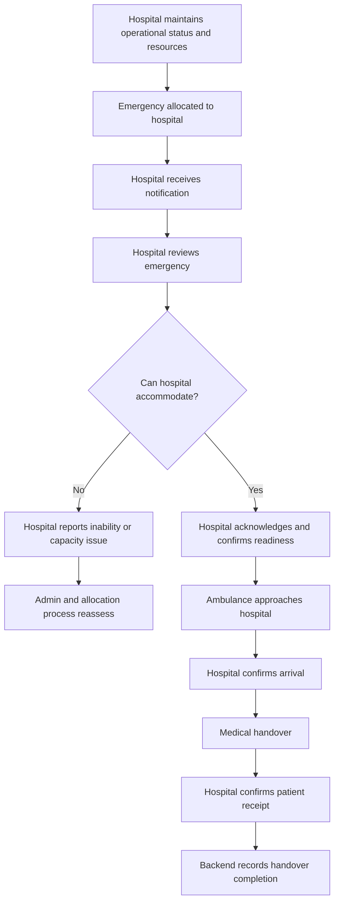

# RAAH — Hospital Staff Portal

**Document Status:** Draft for Team Approval
**Version:** 1.0
**Project:** RAAH
**Last Updated:** 24 November 2026

---

## 1. Purpose

The Hospital Staff Portal is the hospital-facing interface of RAAH.

It allows authorised hospital personnel to manage hospital operations, monitor incoming emergencies, maintain resource availability, coordinate with ambulance drivers and confirm patient handover.

The portal is a separate responsive website connected to the shared RAAH backend.

Each hospital operates within its own authorised portal context. Hospital staff must not be able to access another hospital's private operational information unless explicitly authorised.

## 2. Portal Objectives

The Hospital Staff Portal aims to:

1. Provide secure access to hospital personnel.
2. Provide a central view of hospital operations.
3. Maintain hospital operational status.
4. Manage emergency resource availability.
5. Display incoming emergency allocations.
6. Allow hospitals to acknowledge and respond to emergency requests.
7. Provide visibility into approaching ambulances.
8. Support patient arrival and handover.
9. Maintain traceable records of hospital actions.

## 3. Hospital Account Structure

### 3.1 Hospital Registration

**Priority:** MVP supporting administration workflow

Hospital accounts are created and managed through the Admin / Control Centre.

Hospital registration should capture relevant information, such as:

- Hospital name.
- Address and geographical location.
- Contact details.
- Emergency contact details.
- Available emergency services.
- Relevant specialisations.
- Operational information.

The exact fields must follow the backend data model.

### 3.2 Main Hospital Administrator

**Priority:** MVP

Each hospital has one designated Main Hospital Administrator in the proposed initial account structure.

The Main Hospital Administrator is responsible for:

- Managing hospital-level information.
- Managing authorised staff access.
- Monitoring hospital operations.
- Managing operational settings.
- Reviewing hospital activity.
- Overseeing resource updates.

The Main Hospital Administrator has full permissions within their own hospital's authorised scope, not unrestricted system-wide Admin privileges.

### 3.3 Hospital Staff Roles

The proposed hospital staff roles are:

| Role | Primary responsibilities |
|---|---|
| Main Hospital Administrator | Full hospital-level administration |
| Emergency Coordinator | Incoming emergencies and coordination |
| Bed Manager | Bed and capacity management |
| Medical Coordinator | Medical staff and emergency readiness |
| Resource Manager | Equipment and medical inventory |

Employees may have more than one role.

Permissions should be configurable at the permission level rather than relying exclusively on a single fixed role.

**Important:** These are proposed portal roles. Their mapping to the current backend role model must be verified before implementation.

### 3.4 Staff Invitations

**Priority:** Post-MVP

The Main Hospital Administrator should be able to invite staff through email.

Proposed invitation lifecycle:

1. Administrator enters employee details and assigns roles.
2. System generates an invitation.
3. Employee receives an invitation email.
4. Employee accepts and activates their account.
5. Invitation status changes to accepted.

Proposed invitation states:

- Pending.
- Accepted.
- Expired.
- Revoked.

Invitation expiry, secure activation and permission assignment must be enforced by the backend.

### 3.5 Common Login

The portal should provide one common login interface for hospital employees.

After authentication, the backend determines the employee's hospital association and permissions.

The dashboard and available navigation items should reflect the employee's authorised roles.

## 4. Portal Navigation

Proposed sidebar:

1. Dashboard
2. Hospital Operations
3. Bed and Capacity Management
4. Medical Staff
5. Surgery and OT
6. Equipment and Inventory
7. Emergency Coordination
8. Ambulance Tracking
9. Notifications and Messages
10. Reports and Analytics
11. Staff and Access Management
12. Audit Logs
13. Settings

The initial MVP may use a reduced navigation structure.

## 5. Functional Requirements

### 5.1 Hospital Dashboard

**Priority:** MVP

The dashboard should provide a summary of:

- Hospital profile.
- Current operational status.
- Emergency capacity.
- Essential resource availability.
- Incoming emergencies.
- Active emergency cases.
- Approaching ambulances.
- Outstanding hospital actions.
- Relevant alerts.

Dashboard components must be based on the logged-in employee's permissions.

### 5.2 Hospital Profile Management

**Priority:** MVP basic profile

The portal should display and allow authorised updates to:

- Hospital name.
- Address.
- Contact details.
- Emergency contact information.
- Available departments.
- Specialisations.
- Other approved hospital information.

Sensitive or verification-related fields may require Admin approval.

### 5.3 Hospital Operational Status

**Priority:** MVP

The hospital should be able to report its current operational condition.

Proposed hospital-facing options:

- Fully Operational.
- Limited Capacity.
- Temporarily Unavailable.

These are user-facing requirement labels and are not confirmed to be the current backend enum values.

The status must influence hospital suitability evaluation and allocation.

The backend must validate changes and retain relevant history.

A hospital that becomes unavailable after receiving an allocation must be able to report the change immediately.

The system should then trigger reassessment or Admin intervention as appropriate.

### 5.4 Bed and Capacity Management

**Priority:** MVP essential capacity; detailed management post-MVP

The hospital should maintain availability information for relevant categories:

- General beds.
- ICU beds.
- Emergency beds.

The detailed version may additionally track:

- Occupied beds.
- Available beds.
- Reserved beds.
- Beds under maintenance.
- Beds temporarily unavailable.

Capacity updates must be validated.

The system must distinguish between a general resource availability record and the operational occupancy state of an individual bed.

These concepts should not be combined into one status field without a clear data model.

### 5.5 Department and Specialisation Management

**Priority:** Post-MVP

The hospital should be able to manage its available departments and specialisations.

Examples include:

- Emergency medicine.
- Cardiology.
- Neurology.
- Orthopaedics.
- Obstetrics and gynaecology.
- General surgery.
- Intensive care.

The information may be used by the allocation process to evaluate hospital suitability.

### 5.6 Medical Staff Management

**Priority:** Post-MVP

The portal should eventually support:

- Doctor profiles.
- Medical staff details.
- Specialisations.
- Availability.
- Shift information.
- Assignment to departments.

Only authorised hospital administrators and coordinators should manage these records.

### 5.7 Surgery and Operation Theatre Readiness

**Priority:** Future

Potential functionality:

- OT availability.
- Emergency surgery readiness.
- Theatre scheduling.
- Required specialist availability.
- Equipment readiness.
- Emergency procedure support.

This information may contribute to advanced hospital suitability evaluation.

### 5.8 Equipment Management

**Priority:** Post-MVP

The hospital should eventually be able to maintain information about:

- Emergency equipment.
- ICU equipment.
- Ventilators.
- Defibrillators.
- Monitoring equipment.
- Other critical equipment.

The system should support availability and maintenance states.

### 5.9 Medical Resource and Inventory Management

**Priority:** MVP essential resource availability; detailed inventory post-MVP

The portal should support essential resource availability, such as:

- Oxygen.
- Blood availability.
- Emergency medicines.
- Medical supplies.
- Other relevant emergency resources.

A detailed inventory system may later include:

- Quantity.
- Unit.
- Minimum stock level.
- Reorder threshold.
- Expiry date.
- Storage information.
- Stock movement history.

The MVP should focus on reliable availability information rather than attempting to implement a complete inventory-management system.

### 5.10 Incoming Emergency Requests

**Priority:** MVP

The hospital should be able to view emergencies allocated to it.

The incoming emergency list should display authorised information such as:

- Emergency reference.
- Emergency category.
- Allocation time.
- Patient reference.
- Relevant medical information.
- Ambulance information.
- Estimated arrival where available.
- Current emergency status.

The hospital must not receive unrestricted access to the entire patient directory.

### 5.11 Emergency Allocation and Acknowledgement

**Priority:** MVP

When an emergency is allocated to a hospital, the hospital should receive an appropriate notification.

The hospital should be able to:

- Acknowledge the incoming emergency.
- Confirm readiness.
- Report limited capacity.
- Report inability to accommodate the emergency.
- Provide relevant operational information.

The intended allocation approach is:

1. RESQNET evaluates suitable hospitals.
2. The backend selects or proposes a destination according to the approved workflow.
3. The hospital receives the incoming emergency.
4. The hospital acknowledges or reports an issue.
5. If the hospital cannot accommodate the case, the Admin and allocation process reassess the destination.

The final workflow must specify whether acknowledgement is mandatory before dispatch or whether allocation can proceed automatically.

### 5.12 Emergency Details and Patient Information

**Priority:** MVP

Hospital staff should receive the information required to prepare for the emergency.

Access must be limited by:

- Hospital association.
- Employee role.
- Emergency involvement.
- Operational necessity.
- Applicable consent and emergency-access rules.

Access to sensitive information must be auditable.

### 5.13 Ambulance Tracking

**Priority:** MVP dependency

The portal should display relevant ambulance information:

- Ambulance identification.
- Driver information where permitted.
- Current location.
- Last update.
- Estimated arrival where supported.
- Emergency reference.
- Mission status.

Stale or unavailable location data must be clearly identified.

### 5.14 Hospital Emergency Coordination

**Priority:** MVP

The portal should support coordination with the ambulance and Admin / Control Centre.

Relevant information may include:

- Incoming emergency details.
- Ambulance progress.
- Hospital readiness.
- Changes in resource availability.
- Destination changes.
- Arrival confirmation.
- Handover status.

The backend remains responsible for coordinating shared state.

### 5.15 Patient Arrival and Medical Handover

**Priority:** MVP

The hospital should be able to:

1. View the approaching ambulance.
2. Confirm ambulance arrival.
3. Identify the associated emergency.
4. Receive authorised patient information.
5. Participate in the medical handover.
6. Confirm patient receipt.
7. Submit required handover information.
8. Confirm handover completion.

The backend must validate the handover and record the relevant confirmations.

The emergency must not be considered completed solely because the ambulance reached the hospital.

### 5.16 Notifications and Alerts

**Priority:** MVP basic notifications

The portal should display alerts for:

- New emergency allocation.
- Incoming ambulance.
- Changes in emergency information.
- Hospital readiness issues.
- Resource availability changes.
- Patient arrival.
- Pending handover.
- Relevant Admin instructions.

### 5.17 Hospital Communication

**Priority:** MVP basic coordination

The hospital should have a supported method to communicate with the Control Centre.

The exact implementation may use an existing communication provider or a later messaging module.

Do not assume a complete internal messaging system exists until implemented.

### 5.18 Reports and Analytics

**Priority:** Post-MVP

Potential reports:

- Emergency cases received.
- Emergency cases accepted.
- Emergency cases redirected.
- Hospital response time.
- Handover time.
- Resource availability history.
- Hospital operational performance.

### 5.19 Emergency Readiness and Resource Reservation

**Priority:** Post-MVP

The portal may later support emergency-specific readiness evaluation.

A readiness score could consider:

- Relevant bed availability.
- Required specialisations.
- Medical staff availability.
- Equipment.
- Medical resources.
- Operational status.

**Reservation design decision:** Automated individual bed reservation is not part of the initial MVP until atomic reservation, expiry, release and conflict-handling rules are implemented.

The MVP should focus on reliable availability and hospital readiness confirmation.

### 5.20 Staff Shifts and Availability

**Priority:** Post-MVP

Potential functionality:

- Staff availability.
- Shift schedules.
- Department staffing.
- Emergency coverage.
- Shift handover.

### 5.21 Audit Logs

**Priority:** MVP essential audit events; detailed viewer post-MVP

The system should record important hospital actions, including:

- Operational status changes.
- Resource updates.
- Emergency acknowledgements.
- Readiness responses.
- Patient information access.
- Handover confirmation.
- Staff and permission changes.

### 5.22 Backend Integration and Synchronisation

**Priority:** MVP

The portal must use the shared backend for:

- Hospital information.
- Operational status.
- Resource availability.
- Incoming emergencies.
- Emergency details.
- Ambulance information.
- Arrival and handover.
- Relevant notifications.

All updates must be validated and reflected consistently across relevant portals.

### 5.23 Data Validation and Reliability

**Priority:** MVP

The portal should handle:

- Invalid resource updates.
- Conflicting updates.
- Network failures.
- Failed submissions.
- Stale information.
- Session expiry.
- Unavailable backend services.

Resource updates should use concurrency controls where supported.

A newer update must not silently overwrite another user's concurrent change without appropriate validation.

### 5.24 Future Hospital Management System Integration

**Priority:** Future

RAAH may eventually integrate with external Hospital Management Systems.

Potential integrations include:

- Patient admission systems.
- Bed management.
- Electronic medical records.
- Doctor scheduling.
- Inventory systems.
- Hospital billing and administration.

HMS integration is not assumed to exist in the MVP.

## 6. Hospital Emergency Workflow

The diagram represents the intended workflow. Exact acknowledgement and destination-change rules must follow approved backend logic.

## 7. Backend Integration Requirements

These are functional integration requirements, not claims that every endpoint is already implemented.

| Feature | Backend responsibility |
|---|---|
| Hospital login | Authenticate hospital employee |
| Hospital profile | Retrieve and update authorised hospital data |
| Staff access | Manage employee roles and permissions |
| Operational status | Validate hospital status changes |
| Resources | Create and update resource availability |
| Incoming emergencies | Retrieve allocated cases |
| Emergency details | Provide authorised case information |
| Acknowledgement | Record hospital response |
| Readiness | Record ability to accommodate |
| Ambulance tracking | Retrieve relevant ambulance location |
| Arrival | Record hospital arrival |
| Handover | Record hospital confirmation |
| Notifications | Deliver relevant operational alerts |
| Audit | Record sensitive and operational actions |

Actual routes, payloads, response formats and role permissions must be documented in the backend reference documents.

## 8. Important Design Decisions

The following decisions are proposed for team approval.

### Decision 1: One Hospital per Portal Context

Each hospital operates within its own authorised data scope.

### Decision 2: Separate Hospital Portal

The Hospital Staff Portal remains separate from the Admin / Control Centre Portal.

Both use the shared backend.

### Decision 3: One Main Hospital Administrator

Each hospital has one designated Main Hospital Administrator in the initial account model.

### Decision 4: Multiple Employee Roles

An employee may have multiple roles, subject to backend permission enforcement.

### Decision 5: Manual Resource Updates Initially

Resource availability is initially updated by authorised hospital staff.

### Decision 6: Immediate Availability Change Reporting

A hospital must be able to report an unexpected resource change immediately after allocation.

The system should reassess suitability without an artificial waiting period.

### Decision 7: No Premature Bed Reservation

Automated individual bed reservation is deferred until a reliable reservation model is implemented.

### Decision 8: Conflict Detection

Concurrent resource changes should be detected and handled explicitly.

The system should retain an audit history rather than silently overwriting conflicting updates.

### Decision 9: Need-Based Patient Information

Hospital staff should only access patient information required for the relevant emergency.

### Decision 10: HMS Integration is Future Scope

External HMS integration is not required for the initial MVP.

## 9. Unresolved Decisions

The following must be finalised before the relevant advanced functionality is implemented:

1. What acknowledgement deadline, if any, should apply to an allocated hospital?
2. Should an unacknowledged hospital trigger automatic reassessment, Admin intervention or both?
3. Which resources are mandatory for initial hospital suitability evaluation?
4. Which hospital staff roles are included in the first release?
5. What are the final patient-data access and emergency-disclosure rules?
6. What is the exact hospital status mapping to the backend enum?

## 10. MVP Acceptance Criteria

The Hospital Staff Portal MVP is ready when:

- Authorised hospital staff can log in.
- Staff can access the correct hospital context.
- Hospital profile information can be retrieved.
- Hospital operational status can be updated.
- Essential resource availability can be maintained.
- Incoming allocated emergencies can be viewed.
- Hospital staff can acknowledge or report inability to accommodate.
- Relevant ambulance information can be viewed.
- Hospital arrival can be recorded.
- Hospital staff can confirm patient handover.
- Sensitive patient information is protected.
- Important actions are recorded by the backend.

## 11. Related Documentation

- `../00-project/MVP_SCOPE.md`
- `../00-project/SYSTEM_ARCHITECTURE.md`
- `PATIENT_PORTAL.md`
- `AMBULANCE_PORTAL.md`
- `ADMIN_PORTAL.md`
- `../02-backend/DATABASE_SCHEMA.md`
- `../02-backend/API_ENDPOINTS.md`
- `../02-backend/STATUS_MAPPING.md`
- `../03-workflows/HOSPITAL_WORKFLOW.md`
- `../03-workflows/PATIENT_HANDOVER.md`
