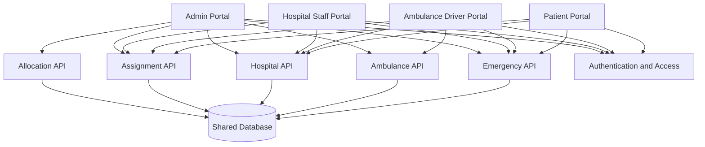

# RAAH — API Integration Map

**Document Status:** Draft — Requires Current Frontend and Backend Verification
**Version:** 1.0
**Project:** RAAH
**Last Updated:** 24 November 2026

---

## 1. Purpose

This document maps the relationship between the four RAAH portals and the shared backend.

It identifies:

- Which portal uses which backend capability.
- Which module owns the operation.
- Which data is retrieved or updated.
- Which workflows depend on multiple modules.
- Which integration capabilities remain pending.

The purpose is to prevent duplicated business logic and inconsistent frontend implementations.

## 2. Integration Architecture

All four portals communicate with the same backend.

The diagram represents the intended integration structure. Allocation API availability and authentication coverage require verification.

## 3. Portal-to-Backend Integration Matrix

| Portal | Backend module or capability | Main integration purpose |
| --- | --- | --- |
| Patient | Authentication | Patient access |
| Patient | Emergencies | Create and track emergencies |
| Patient | Ambulances / Assignments | View assigned ambulance |
| Patient | Hospitals | View destination hospital |
| Patient | Medical information | Retrieve authorised patient data |
| Patient | Cura Card | Secure patient identification |
| Ambulance | Authentication | Driver access |
| Ambulance | Ambulances | Retrieve and update authorised ambulance information |
| Ambulance | Assignments | Accept, reject and progress missions |
| Ambulance | Emergencies | Retrieve authorised emergency details |
| Ambulance | Location | Submit location updates |
| Ambulance | Hospitals | Retrieve selected destination |
| Hospital | Authentication | Hospital employee access |
| Hospital | Hospitals | Manage hospital information |
| Hospital | Resources | Update resource availability |
| Hospital | Emergencies | Retrieve incoming allocated emergencies |
| Hospital | Assignments | View relevant ambulance mission |
| Hospital | Handover | Confirm patient receipt |
| Admin | Authentication | Administrative access |
| Admin | Emergencies | Monitor emergency cases |
| Admin | Ambulances | Manage ambulance records |
| Admin | Hospitals | Manage hospitals |
| Admin | Resources | Monitor hospital resources |
| Admin | Assignments | Create and manage assignments |
| Admin | Allocation | Retrieve recommendations |
| Admin | Audit and events | Review operational activity |

The matrix lists intended capabilities. A listed integration does not establish that a corresponding API already exists.

## 4. Module Ownership

### 4.1 Emergencies Module

Owns:

- Emergency creation.
- Emergency retrieval.
- Emergency listing.
- Emergency status lifecycle.
- Emergency-related case events.
- Emergency resolution information.

Consumers:

- Patient Portal.
- Ambulance Driver Portal.
- Hospital Staff Portal.
- Admin Portal.

### 4.2 Ambulances Module

Owns:

- Ambulance records.
- Ambulance information.
- Ambulance status.
- Ambulance retrieval and listing.

Consumers:

- Ambulance Driver Portal.
- Admin Portal.
- Allocation logic.
- Other portals through authorised assignment-related information.

### 4.3 Hospitals Module

Owns:

- Hospital records.
- Hospital information.
- Hospital operational status.
- Hospital resource records.

Consumers:

- Hospital Staff Portal.
- Admin Portal.
- Allocation logic.
- Patient Portal for authorised destination information.
- Ambulance Portal for selected destination information.

### 4.4 Assignments Module

Owns:

- Assignment creation.
- Assignment validation.
- Driver acceptance.
- Driver rejection.
- Assignment lifecycle.
- Related ambulance and emergency updates.

Consumers:

- Ambulance Driver Portal.
- Admin Portal.
- Patient Portal for relevant assignment information.
- Hospital Portal for relevant incoming mission information.

### 4.5 Allocation Module

**Status:** Verified Operational API (M5.3 Stage 2 Accepted)

Owns:

- Ambulance candidate evaluation and ranking.
- Hospital candidate evaluation and ranking.
- Operational suitability scoring (optimal, suitable, requires review, disqualified).
- Read-only recommendation generation (`GET /api/v1/emergencies/:id/ambulance-recommendations`, `GET /api/v1/emergencies/:id/hospital-recommendations`).
- Destination hospital selection and reassignment (`PATCH /api/v1/emergencies/:id/destination`).
- Operational safety guards (hard blocks on `CLOSED` and `DIVERTING` hospitals, non-overridable blocks on depleted/incompatible required resources).
- Optimistic concurrency control via conditional database updates (`updateMany` matching expected status and previous destination).
- Dispatcher review validation (minimum 10 non-whitespace character override justifications).

The Allocation module recommends candidates and records destination selection.

The Assignment module executes the actual ambulance assignment (`POST /api/v1/emergencies/:emergencyId/assignments`). The Allocation module does not duplicate assignment execution.

### 4.6 Handovers Module

**Status:** Verified Operational API (M5.4 Implemented & Accepted; M6.1 / M6.2 E2E Verified)

Owns:

- Handover initiation (`POST /api/v1/handovers`).
- Handover retrieval and history (`GET /api/v1/handovers/:id`, `GET /api/v1/handovers/case/:caseId/active`, `GET /api/v1/handovers/case/:caseId`).
- Handover data entry updates (`PATCH /api/v1/handovers/:id`).
- Handover completion (`POST /api/v1/handovers/:id/complete` — atomic case resolution, assignment completion, ambulance fleet release).
- Handover rejection (`POST /api/v1/handovers/:id/reject` — hospital rejection, preserves ambulance in `PATIENT_ONBOARD`, case reverts to `ARRIVED_AT_HOSPITAL`).
- Handover cancellation (`POST /api/v1/handovers/:id/cancel`).
- Single active handover protection (service-level conflict guard + PostgreSQL partial unique index).
- Handover lifecycle events (`HANDOVER_STARTED`, `HANDOVER_COMPLETED`, `HANDOVER_REJECTED`, `HANDOVER_CANCELLED`, `CASE_COMPLETED`).

Consumers:

- Ambulance Driver Portal (submits vitals, initiates handover, views active status).
- Hospital Staff Portal (receives patient, accepts/completes handover, rejects with reason).
- Admin Portal (monitors handover progress, emergency resolution, and audit history).

## 5. Core Emergency Integration Flow

### Step 1: Patient Creates Emergency

**Portal:** Patient

**Backend responsibility:** Emergencies

The Patient Portal submits the emergency information.

The backend:

- Validates the request.
- Creates the emergency record.
- Generates or associates the emergency reference.
- Records the initial status and relevant events.

**Output:** Backend-confirmed emergency record.

### Step 2: Ambulance Candidate Evaluation

**Initiating system:** Backend / RESQNET / Dispatcher

**Backend responsibility:** Allocation (`GET /api/v1/emergencies/:id/ambulance-recommendations`)

The allocation process evaluates eligible ambulance candidates using incident pickup coordinates.

Evaluation criteria:

- Proximity and estimated travel time.
- Vehicle operational status and availability.
- Vehicle capability matches.
- Disqualification filtering (`includeDisqualified=true` default keeps disqualified visible with reasons).
- Geographic search radius (`maxRangeKm`, with unlocated candidates preserved for review).

**Output:** Ranked ambulance recommendations (read-only, no side effects).

**Integration status:** Verified Operational API (M5.3 Stage 2).

### Step 3: Ambulance Assignment

**Portal:** Admin or authorised backend workflow

**Backend responsibility:** Assignments

The Assignment service:

- Validates the emergency.
- Validates ambulance availability.
- Prevents conflicting active assignments.
- Creates the assignment.
- Updates related records.
- Records relevant events.

**Output:** Validated ambulance assignment.

### Step 4: Driver Receives Dispatch

**Portal:** Ambulance Driver

**Backend responsibility:** Assignments and notification capability

The driver retrieves or receives the assigned mission.

The driver accepts or rejects it.

Rejection requires a reason and must be recorded.

### Step 5: Hospital Candidate Evaluation

**Initiating system:** Backend / RESQNET / Dispatcher

**Backend responsibility:** Allocation (`GET /api/v1/emergencies/:id/hospital-recommendations`)

The system evaluates hospital suitability using emergency pickup coordinates, clinical requirements, and real-time hospital resource state.

Evaluation criteria:

- Proximity and estimated travel time (straight-line from pickup coordinates to hospital).
- Operational status (`OPERATIONAL`, `BUSY`, `DIVERTING`, `CLOSED`).
- Required resource stock and status (`availableQuantity`, operational status).
- Required clinical capability matching.
- Disqualification filtering and warning review flags.

**Output:** Ranked hospital recommendations (read-only decision support, non-binding).

**Integration status:** Verified Operational API (M5.3 Stage 2).

### Step 6: Destination Selection

**Portal:** Admin / Dispatcher or authorised backend workflow

**Backend responsibility:** Allocation (`PATCH /api/v1/emergencies/:id/destination`)

The dispatcher or system selects or reassigns the destination hospital.

Enforced controls:

- Valid status guard: Only allowed when emergency is `PATIENT_ONBOARD`, `HOSPITAL_SELECTED`, `HOSPITAL_NOTIFIED`, or `EN_ROUTE_TO_HOSPITAL`.
- Hard operational blocks: `CLOSED` and `DIVERTING` hospitals are strictly rejected (overrides not permitted).
- Hard resource blocks: Depleted or non-operational required resources (`availableQuantity: 0`, `UNAVAILABLE`, `MAINTENANCE`) are strictly rejected.
- Justified override: Hospitals in `REQUIRES_REVIEW` (e.g. `BUSY`, `LOW_STOCK`) require a verified `overrideReason` of >= 10 non-whitespace characters.
- Optimistic concurrency control: Conditional `updateMany` matching `{ id, status, destinationHospitalId }` throws `409 Conflict` on race conditions.
- Idempotency: Selecting the same destination hospital preserves active operational progress and suppresses redundant events.
- Audit logging: Emits `HOSPITAL_SELECTED` on initial selection or `DESTINATION_CHANGED` on reassignment.

**Output:** Updated emergency record with associated destination hospital.

**Integration status:** Verified Operational API (M5.3 Stage 2).

### Step 7: Hospital Receives Emergency

**Portal:** Hospital Staff

**Backend responsibility:** Hospitals and Emergencies

The hospital retrieves incoming allocated emergencies and relevant authorised information.

The hospital acknowledges readiness or reports a problem.

### Step 8: Ambulance and Hospital Coordination

**Portals:** Ambulance Driver and Hospital Staff

**Backend responsibility:** Assignments, Emergencies, Hospitals and location capability

The system shares relevant mission and arrival information.

Location and status updates must be timestamped and validated.

### Step 9: Patient Handover

**Portals:** Ambulance Driver and Hospital Staff

**Backend responsibility:** Handovers (`POST /api/v1/handovers`, `POST /api/v1/handovers/:id/complete`, `reject`, `cancel`)

The paramedic or intake team initiates the handover record (`POST /api/v1/handovers`) once the case is in `ARRIVED_AT_HOSPITAL` and ambulance is in `PATIENT_ONBOARD`.

The receiving hospital doctor accepts and completes the handover (`POST /api/v1/handovers/:id/complete`), atomically completing the handover, resolving the emergency case (`COMPLETED`, `resolvedAt`), completing the assignment (`COMPLETED`, `completedAt`), and releasing the ambulance back to the available fleet (`AVAILABLE`, `isAvailable: true`).

Alternatively, the hospital may reject (`POST /api/v1/handovers/:id/reject`) or cancel (`POST /api/v1/handovers/:id/cancel`) with a mandatory reason, reverting the case to `ARRIVED_AT_HOSPITAL` while retaining the ambulance in `PATIENT_ONBOARD` for dispatcher rerouting.

**Integration status:** Verified Operational API (M5.4 Implemented & Conditionally Accepted; M6.1 Mocked E2E & M6.2 Stateful DB-backed E2E Verified). Remote Supabase migrations pending deployment.

### Step 10: Emergency Completion

**Backend responsibility:** Emergencies and Assignments

The backend validates the required completion conditions.

The final status is made available to authorised portals.

## 6. Data Ownership and Update Rules

| Information | Authoritative owner | Other portal behaviour |
| --- | --- | --- |
| Emergency status | Backend Emergency lifecycle | Display and retrieve |
| Ambulance assignment | Assignment service | Display and authorised actions |
| Ambulance availability | Backend Ambulance lifecycle | Display and authorised updates |
| Hospital status | Backend Hospital lifecycle | Display and authorised updates |
| Hospital resources | Backend Hospital resource records | Display and authorised updates |
| Hospital destination | Validated backend workflow | Display and authorised destination actions |
| Ambulance location | Backend location record | Submit or display according to permission |
| Handover completion | Backend handover workflow | Submit confirmation and display result |
| Patient medical information | Authorised patient-data backend capability | Restricted retrieval |
| Case event history | Backend case event records | Display authorised history |

No frontend should maintain an independent authoritative copy of these values.

## 7. Integration Requirements by Data Flow

### 7.1 Patient to Backend

- Submit emergency.
- Submit location.
- Retrieve emergency status.
- Retrieve relevant ambulance information.
- Retrieve selected hospital information.
- Retrieve authorised medical information.

### 7.2 Ambulance to Backend

- Retrieve assignments.
- Accept or reject assignments.
- Submit mission status.
- Submit location.
- Record pickup and arrival.
- Confirm handover.

### 7.3 Hospital to Backend

- Retrieve hospital information.
- Update operational status.
- Update resource availability.
- Retrieve incoming emergencies.
- Acknowledge emergency.
- Submit readiness response.
- Confirm patient arrival.
- Confirm handover.

### 7.4 Admin to Backend

- Retrieve system-wide emergency information.
- Register ambulances.
- Manage drivers.
- Register and manage hospitals.
- Monitor resources.
- Retrieve recommendations.
- Create validated assignments.
- Select destinations.
- Perform authorised interventions.
- Review operational history.

## 8. Real-Time Synchronisation Requirements

The integrated system should keep relevant portal information up to date.

Important events include:

- Emergency created.
- Ambulance assigned.
- Assignment accepted or rejected.
- Destination selected.
- Hospital notified.
- Ambulance location updated.
- Ambulance arrived at pickup.
- Patient onboard.
- Ambulance arrived at hospital.
- Hospital handover confirmation.
- Emergency completed.

The implementation may use WebSockets, server-sent events or controlled polling.

The actual transport mechanism must be verified.

All clients must handle:

- Network disconnection.
- Delayed updates.
- Failed submissions.
- Duplicate event delivery.
- Stale location data.
- Session expiry.

## 9. Error Handling and Consistency

Integration failures must be handled without creating contradictory operational states.

Examples:

- An assignment rejection must not be displayed as acceptance.
- A failed emergency submission must not be shown as a confirmed emergency.
- A stale GPS update must not be displayed as live.
- A hospital resource update conflict must be reported.
- An invalid destination change must not overwrite the existing destination.
- A failed handover confirmation must not mark the emergency completed.

The backend must validate all operations and return consistent responses.

## 10. Integration Verification Checklist

### Patient Portal

- [ ] Authentication integration verified.
- [ ] Emergency creation verified.
- [ ] Emergency retrieval verified.
- [ ] Location integration verified.
- [ ] Assignment information retrieval verified.
- [ ] Hospital information retrieval verified.
- [ ] Medical data permissions verified.
- [ ] Cura Card integration verified.

### Ambulance Portal

- [ ] Driver authentication verified.
- [ ] Ambulance association verified.
- [ ] Assignment retrieval verified.
- [ ] Assignment acceptance verified.
- [ ] Assignment rejection verified.
- [ ] Mission status integration verified.
- [ ] GPS integration verified.
- [x] Handover integration verified (backend API layer verified in M5.4 / M6.2; portal UI pending).

### Hospital Portal

- [ ] Employee authentication verified.
- [ ] Hospital association verified.
- [ ] Hospital profile integration verified.
- [ ] Resource integration verified.
- [ ] Incoming emergency retrieval verified.
- [ ] Hospital acknowledgement verified.
- [ ] Arrival confirmation verified.
- [x] Handover integration verified (backend API layer verified in M5.4 / M6.2; portal UI pending).

### Admin Portal

- [ ] Admin authentication verified.
- [ ] Emergency monitoring verified.
- [ ] Ambulance management verified.
- [ ] Driver management verified.
- [ ] Hospital management verified.
- [ ] Resource monitoring verified.
- [x] Allocation integration verified.
- [x] Assignment integration verified (backend API layer verified in M6.1 / M6.2).
- [x] Destination selection verified.
- [x] Audit and event history verified (CaseEvent trail verified in M6.1 / M6.2).

## 11. Integration Completion Criteria

The integration layer can be considered complete when:

1. All four portals use the shared backend.
2. Each portal has documented API contracts.
3. Backend authorisation is enforced.
4. Emergency status remains consistent across portals.
5. Assignment state remains consistent across portals.
6. Hospital destination is consistent across portals.
7. Resource updates are validated.
8. Location data has reliable timestamps and freshness handling.
9. Handover is validated by the backend.
10. Critical integration workflows have automated tests.

## 12. Related Documentation

- `DATABASE_SCHEMA.md`
- `API_ENDPOINTS.md`
- `STATUS_MAPPING.md`
- `../00-project/SYSTEM_ARCHITECTURE.md`
- `../00-project/MVP_SCOPE.md`
- `../01-portals/PATIENT_PORTAL.md`
- `../01-portals/AMBULANCE_PORTAL.md`
- `../01-portals/HOSPITAL_PORTAL.md`
- `../01-portals/ADMIN_PORTAL.md`
- `../03-workflows/EMERGENCY_LIFECYCLE.md`
- `../03-workflows/AMBULANCE_WORKFLOW.md`
- `../03-workflows/HOSPITAL_WORKFLOW.md`
- `../03-workflows/PATIENT_HANDOVER.md`
