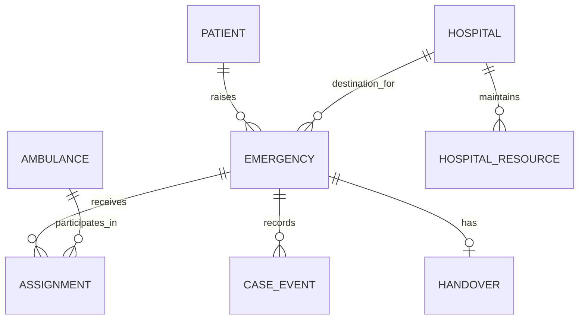

# RAAH — Database Schema Reference

**Document Status:** Draft — Requires Prisma Schema Verification
**Version:** 1.0
**Project:** RAAH
**Last Updated:** 24 November 2026

---

## 1. Purpose

This document describes the database structure used by the RAAH backend.

It is intended to provide a shared reference for:

- Database models.
- Model relationships.
- Primary responsibilities.
- Important status fields.
- Data ownership.
- Referential integrity.
- Database constraints.
- Portal integration requirements.

The database is shared across all four RAAH portals.

The Prisma schema is the authoritative source for the actual database model.

**Verification rule:** Do not treat a proposed field, relationship or model in this document as implemented until it has been checked against the current Prisma schema.

## 2. Database Architecture

The backend uses Prisma as its data access layer.

The intended architecture is:

```text
Patient Portal
       |
Ambulance Portal
       |
Hospital Portal
       |
Admin Portal
       |
       v
RAAH NestJS Backend
       |
       v
Prisma Data Access Layer
       |
       v
Shared Database
```

All portals interact with persistent data through backend APIs.

The frontend must not access or modify the database directly.

## 3. Core Domain Areas

The database is organised around the following major domain areas.

| Domain | Responsibility |
| --- | --- |
| Users and authentication | Identity and access |
| Patients | Patient identity and medical information |
| Emergencies | Emergency case records and lifecycle |
| Ambulances | Ambulance records and availability |
| Hospitals | Hospital information and operations |
| Hospital resources | Resource availability |
| Assignments | Ambulance-to-emergency assignments |
| Case events | Emergency activity history |
| Handover | Patient transfer and confirmation |
| Notifications | Operational communication |
| Audit | Sensitive and administrative activity |

The exact implemented models for each domain must be verified.

## 4. Emergency Domain

### 4.1 Purpose

The Emergency domain stores and manages emergency cases raised through RAAH.

It is responsible for maintaining the authoritative emergency record throughout the response lifecycle.

### 4.2 Known Implementation Evidence

The previously inspected backend contains emergency-related service functionality for:

- Creating emergency records.
- Generating unique case numbers.
- Validating patient or initiator information.
- Retrieving emergency records.
- Listing emergencies with pagination.
- Updating emergency status.
- Recording case events.
- Tracking resolution timestamps.

The Prisma schema must be rechecked to establish the exact model name and fields.

### 4.3 Important Domain Information

The emergency record is expected to represent:

- Emergency identity.
- Patient association.
- Emergency category.
- Emergency location.
- Emergency status.
- Assignment association or history.
- Destination hospital.
- Creation and update timestamps.
- Resolution information.

These are domain requirements. Exact field names and nullability must be copied from the schema.

### 4.4 Destination Hospital

A previously inspected implementation uses `destinationHospitalId` to represent the selected hospital association.

Its exact relation, constraints and update behaviour must be verified in the current Prisma schema.

Destination changes should be validated and recorded as operational events.

## 5. Ambulance Domain

### 5.1 Purpose

The Ambulance domain represents vehicles participating in emergency response.

### 5.2 Responsibilities

- Ambulance registration.
- Ambulance retrieval.
- Vehicle information.
- Operational availability.
- Capability information.
- Assignment association.
- Operational status updates.

### 5.3 Important Relationships

An ambulance may be associated with:

- One or more authorised drivers over time.
- Its active or historical assignments.
- Relevant operational location information.
- Vehicle capability information.

The exact cardinality and relationship names must be verified from Prisma.

### 5.4 Data Integrity Requirements

The database and assignment service must prevent an ambulance from receiving conflicting active assignments.

Ambulance status must remain consistent with its active assignment state.

## 6. Hospital Domain

### 6.1 Purpose

The Hospital domain stores hospital information and supports hospital operations.

### 6.2 Responsibilities

- Hospital registration.
- Hospital profile.
- Contact information.
- Operational status.
- Resource associations.
- Destination selection.
- Emergency coordination.

### 6.3 Hospital Resources

A previously inspected backend contains hospital resource functionality.

Known resource status values include:

- `AVAILABLE`
- `LOW_STOCK`
- `UNAVAILABLE`
- `MAINTENANCE`

The exact model, fields, resource categories and relationships must be rechecked against Prisma.

### 6.4 Resource Versioning

A previously inspected HospitalResource model contains a version field.

This may support optimistic concurrency control for resource updates.

The exact implementation must be verified before treating it as an active concurrency guarantee.

## 7. Assignment Domain

### 7.1 Purpose

The Assignment domain records the relationship between an emergency and an assigned ambulance.

### 7.2 Responsibilities

- Create an assignment.
- Validate emergency eligibility.
- Validate ambulance eligibility.
- Prevent conflicting active assignments.
- Record acceptance.
- Record rejection.
- Track mission progress.
- Update related emergency and ambulance states.
- Record case events.

### 7.3 Important Relationships

An assignment is expected to connect:

- An emergency.
- An ambulance.
- Relevant driver information, where represented by the data model.
- Assignment status and lifecycle information.

Exact field names, relationships and constraints must be verified from the current schema.

### 7.4 Transactional Integrity

Assignment creation affects multiple records.

The backend should use database transactions where necessary to ensure that:

- The assignment is created consistently.
- Ambulance availability is updated.
- Emergency state is updated.
- Related case events are recorded.

Concurrency protection must be evaluated to prevent two dispatch operations from creating conflicting assignments.

## 8. Case Event Domain

### 8.1 Purpose

Case events provide an immutable, traceable audit record of all operational and clinical activities throughout an emergency.

### 8.2 Schema Definition

Model: `CaseEvent`

| Field | Type | Attributes | Description |
|---|---|---|---|
| `id` | String | `@id @default(uuid())` | Unique event ID |
| `caseId` | String | Foreign key to `EmergencyCase` | Case identifier (`onDelete: Cascade`) |
| `eventType` | `CaseEventType` | Enum | Classification of operational event |
| `actorId` | String? | Nullable | User ID of person triggering the action |
| `notes` | String? | Nullable | Human-readable event description |
| `payload` | Json? | Nullable | Structured JSON payload with event parameters |
| `createdAt` | DateTime | `@default(now())` | Creation timestamp |

### 8.3 CaseEventType Enum Values

The complete `CaseEventType` enum defined in `schema.prisma` contains:

```prisma
enum CaseEventType {
  SOS_INITIATED
  CASE_CREATED
  AMBULANCE_ASSIGNED
  AMBULANCE_ACCEPTED
  AMBULANCE_REJECTED
  AMBULANCE_EN_ROUTE
  ARRIVED_AT_SCENE
  PATIENT_ONBOARD
  HOSPITAL_SELECTED
  HOSPITAL_NOTIFIED
  HOSPITAL_ACCEPTED
  HOSPITAL_REDIRECTED
  DESTINATION_CHANGED
  CONDITION_UPDATED
  DELAY_REPORTED
  PATIENT_ARRIVED
  HANDOVER_STARTED
  HANDOVER_COMPLETED
  HANDOVER_REJECTED
  HANDOVER_CANCELLED
  CASE_COMPLETED
  CASE_CANCELLED
}
```

*Note on M5.4 Migration:* `HANDOVER_REJECTED` and `HANDOVER_CANCELLED` were added via migration `20261124231000_add_handover_rejected_cancelled_events/migration.sql` to provide accurate event semantics for rejected and cancelled handovers (replacing generic redirection or condition updates).

---

## 9. Handover Domain

### 9.1 Purpose

The Handover domain governs the digital transfer of patient responsibility from ambulance crews to hospital emergency department personnel upon physical arrival at the destination hospital.

### 9.2 Handover Model Definition

Model: `Handover`

| Field | Type | Nullable | Attributes | Description |
|---|---|---|---|---|
| `id` | String | No | `@id @default(uuid())` | Primary key |
| `caseId` | String | No | Foreign Key to `EmergencyCase` (`onDelete: Cascade`) | Emergency case being handed over |
| `ambulanceId` | String | No | Foreign Key to `Ambulance` (`onDelete: Cascade`) | Delivering ambulance |
| `hospitalId` | String | No | Foreign Key to `Hospital` (`onDelete: Cascade`) | Receiving hospital |
| `paramedicId` | String | Yes | Foreign Key to `User` (`@relation("ParamedicHandovers")`, `onDelete: SetNull`) | Handing-over crew member |
| `receivingDoctorId` | String | Yes | Foreign Key to `User` (`@relation("DoctorHandovers")`, `onDelete: SetNull`) | Receiving hospital medical staff |
| `status` | `HandoverStatus` | No | `@default(PENDING)` | Current status of handover |
| `clinicalSummary` | String | Yes | Text (up to 5000 chars) | Pre-hospital clinical summary |
| `patientCondition` | String | Yes | Text (up to 1000 chars) | Condition upon physical arrival |
| `vitals` | Json | Yes | JSON object | Structured vitals (`VitalsDto`) |
| `notes` | String | Yes | Text (up to 2000 chars) | Operational and transfer notes |
| `handoverStartedAt` | DateTime | No | `@default(now())` | Initiation timestamp |
| `handoverCompletedAt` | DateTime | Yes | Nullable | Final completion timestamp |
| `createdAt` | DateTime | No | `@default(now())` | Record creation timestamp |
| `updatedAt` | DateTime | No | `@updatedAt` | Last modification timestamp |

### 9.3 HandoverStatus Enum

```prisma
enum HandoverStatus {
  PENDING
  IN_PROGRESS
  COMPLETED
  REJECTED
  CANCELLED
}
```

### 9.4 Database Indexes and Partial Unique Constraint

The `Handover` table defines standard indexes:
- `@@index([caseId])`
- `@@index([ambulanceId])`
- `@@index([hospitalId])`
- `@@index([paramedicId])`
- `@@index([receivingDoctorId])`
- `@@index([status])`

**Active Handover Uniqueness Guarantee:**
A PostgreSQL partial unique index is defined in migration `20261124230000_add_active_handover_partial_unique_index/migration.sql`:
```sql
CREATE UNIQUE INDEX "Handover_active_case_unique"
ON "Handover"("caseId")
WHERE "status" IN ('PENDING', 'IN_PROGRESS');
```
This guarantees at the database engine level that no emergency case can ever have more than one active handover concurrently, preventing race conditions during simultaneous initiation requests.

### 9.5 State Transitions & Transactional Integrity

Handover operations enforce atomic transitions across multiple models within Prisma `$transaction` blocks:

| Operation | Handover Status | EmergencyCase Status | Assignment Status | Ambulance Status | Emitted CaseEvents |
|---|---|---|---|---|---|
| **Initiate** | `IN_PROGRESS` | `ARRIVED_AT_HOSPITAL` → `HANDOVER_IN_PROGRESS` | `PATIENT_ONBOARD` (unchanged) | `PATIENT_ONBOARD` (unchanged) | `HANDOVER_STARTED` |
| **Complete** | `COMPLETED` (`handoverCompletedAt: now()`) | `COMPLETED` (`resolvedAt: now()`) | `COMPLETED` (`completedAt: now()`) | `AVAILABLE` (`isAvailable: true`) | `HANDOVER_COMPLETED`, `CASE_COMPLETED` |
| **Reject** | `REJECTED` (appends reason to notes) | Reverts to `ARRIVED_AT_HOSPITAL` | `PATIENT_ONBOARD` (retained, crew not released) | `PATIENT_ONBOARD` (retained, vehicle not released) | `HANDOVER_REJECTED` |
| **Cancel** | `CANCELLED` (appends reason to notes) | Reverts to `ARRIVED_AT_HOSPITAL` | `PATIENT_ONBOARD` (retained) | `PATIENT_ONBOARD` (retained) | `HANDOVER_CANCELLED` |

*Operational Rerouting Note:* When a handover is rejected, the patient remains physically at the hospital grounds in the care of the ambulance crew. The ambulance is **not** released. Subsequent diversion or reassignment of the destination hospital is handled via the separate dispatcher destination selection API (`PATCH /api/v1/emergencies/:id/destination`).

### 9.6 Migration Status Notice

**Important:** The following migrations have been authored and committed in `backend/prisma/migrations/`:
1. `20261124230000_add_active_handover_partial_unique_index/migration.sql`
2. `20261124231000_add_handover_rejected_cancelled_events/migration.sql`

These migrations exist locally and in version control, but **have not yet been deployed to the live remote Supabase PostgreSQL database**. They must be applied using `pnpm exec prisma migrate deploy` during the next scheduled database maintenance window.

## 10. User and Role Domain

The portal architecture requires distinct access scopes for:

- Patients.
- Ambulance drivers.
- Hospital employees.
- Super Administrators.

Previously inspected backend role information included values such as `HOSPITAL_ADMIN` and `DOCTOR`.

The complete enum and its mapping to the proposed hospital employee roles must be verified.

The proposed multiple-role hospital employee model is not confirmed merely because individual role values exist.

## 11. Data Relationships

The following diagram illustrates the intended conceptual relationships. It is not a substitute for the actual Prisma relation diagram.



The diagram uses conceptual entity names. Actual Prisma model names and relationship cardinalities must be verified.

## 12. Data Integrity Requirements

The database and backend must enforce:

1. Valid foreign-key relationships.
2. Unique identifiers where required.
3. Valid emergency status transitions.
4. Valid assignment relationships.
5. Protection against conflicting active assignments.
6. Valid hospital references.
7. Consistent resource updates.
8. Traceable operational events.
9. Appropriate deletion and archival rules.
10. Protection of sensitive patient information.

## 13. Concurrency and Transaction Requirements

Important concurrent operations include:

- Two Admin users attempting to assign the same ambulance.
- Two ambulances being assigned to the same emergency.
- Multiple hospital staff updating the same resource.
- A hospital changing availability while an emergency is being allocated.
- A destination hospital changing after an assignment is created.

The backend should use appropriate transactions, unique constraints, conditional updates or optimistic concurrency controls.

Resource updates should not silently overwrite concurrent changes.

## 14. Schema Verification Checklist

Before marking this document verified, inspect the current Prisma schema and record:

- [ ] Actual database provider.
- [ ] All model names.
- [ ] All enum names and values.
- [ ] Primary keys.
- [ ] Foreign keys.
- [ ] Unique constraints.
- [ ] Indexes.
- [ ] Required and optional fields.
- [ ] Relation cardinalities.
- [ ] Default values.
- [ ] Timestamp fields.
- [ ] Cascade and deletion behaviour.
- [ ] Transaction-related constraints.
- [ ] Handover-related models.
- [ ] User and role relationships.
- [ ] Patient medical information models.
- [ ] Location-related models or fields.

## 15. Related Documentation

- `../00-project/SYSTEM_ARCHITECTURE.md`
- `../00-project/MVP_SCOPE.md`
- `API_ENDPOINTS.md`
- `API_INTEGRATION_MAP.md`
- `STATUS_MAPPING.md`
- `../03-workflows/EMERGENCY_LIFECYCLE.md`
- `../03-workflows/PATIENT_HANDOVER.md`
