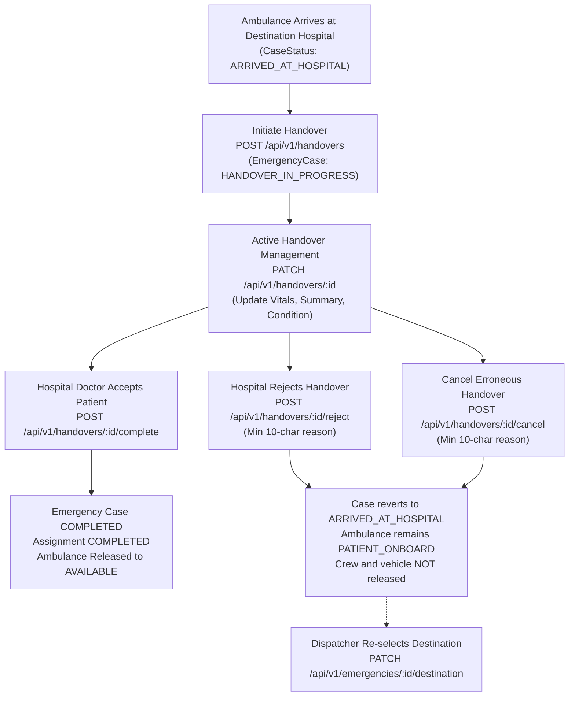

# RAAH – Patient Handover Workflow

## 1. Purpose

This document defines the patient handover process between the ambulance team and the receiving hospital.

The objective is to ensure that essential patient identity, emergency details and relevant observations are communicated to authorised hospital staff during transfer of care.

## 2. Participants

- **Patient:** Person receiving emergency assistance.
- **Ambulance Driver / Crew:** Transports the patient and communicates available emergency information.
- **Receiving Hospital Staff:** Accepts the patient and receives relevant information.
- **Dispatcher:** Coordinates the emergency response when required.
- **Backend:** Maintains the associated emergency and assignment records.

## 3. Handover Workflow Overview

The implemented digital handover process proceeds through structured lifecycle stages backed by atomic database transactions:

### Detailed Lifecycle Steps

1. **Physical Arrival:** The ambulance reaches the destination hospital grounds. The emergency case status must be updated to `ARRIVED_AT_HOSPITAL`. Handover cannot be initiated while the vehicle is still `EN_ROUTE_TO_HOSPITAL`.
2. **Initiation (`POST /api/v1/handovers`):**
   - The crew or hospital intake desk initiates the handover.
   - The backend validates that:
     - Case exists and is in `ARRIVED_AT_HOSPITAL` status.
     - `destinationHospitalId` is assigned to the case.
     - An active assignment exists with status `PATIENT_ONBOARD`.
     - No existing active (`PENDING` or `IN_PROGRESS`) handover exists for this case (enforced by application check and PostgreSQL partial unique index).
   - In a single atomic transaction:
     - A `Handover` record is created in status `IN_PROGRESS`.
     - The `EmergencyCase` status transitions to `HANDOVER_IN_PROGRESS`.
     - An audit event `HANDOVER_STARTED` is recorded.
     - The ambulance and assignment remain in `PATIENT_ONBOARD`.
3. **Active Handover Updates (`PATCH /api/v1/handovers/:id`):**
   - Authorised staff can progressively record or update clinical summaries, observed condition, and structured vital signs (`VitalsDto`: heart rate, blood pressure, respiratory rate, SpO2, temperature, GCS, blood glucose, pain score).
   - Updates are permitted only while the handover is active (`PENDING` or `IN_PROGRESS`).
4. **Completion (`POST /api/v1/handovers/:id/complete`):**
   - Hospital doctor or receiving staff confirm transfer of clinical responsibility.
   - In a single atomic transaction:
     - Handover is marked `COMPLETED` (`handoverCompletedAt = now()`).
     - EmergencyCase transitions to `COMPLETED` (`resolvedAt = now()`).
     - Assignment transitions to `COMPLETED` (`completedAt = now()`).
     - Ambulance is released back to the operational fleet (`status: AVAILABLE`, `isAvailable: true`).
     - Audit events `HANDOVER_COMPLETED` and `CASE_COMPLETED` are recorded.
5. **Rejection (`POST /api/v1/handovers/:id/reject`):**
   - If the receiving hospital cannot accept the patient (e.g. emergency diversion, unexpected facility shutdown, or critical resource outage), the hospital records a formal rejection.
   - Requires a meaningful justification containing at least 10 non-whitespace characters.
   - In a single atomic transaction:
     - Handover status transitions to `REJECTED`.
     - EmergencyCase reverts to `ARRIVED_AT_HOSPITAL`.
     - **Ambulance and crew are NOT released:** Ambulance and assignment remain in status `PATIENT_ONBOARD`.
     - Dedicated audit event `HANDOVER_REJECTED` is recorded.
   - **Subsequent Rerouting:** Rerouting the patient to an alternate facility is a separate subsequent operation performed by dispatchers via `PATCH /api/v1/emergencies/:id/destination`.
6. **Cancellation (`POST /api/v1/handovers/:id/cancel`):**
   - If a handover record was created erroneously (e.g. administrative mis-entry), it can be cancelled with a mandatory reason (min 10 characters).
   - In a single transaction, the handover is marked `CANCELLED`, the case reverts to `ARRIVED_AT_HOSPITAL`, the ambulance remains `PATIENT_ONBOARD`, and a `HANDOVER_CANCELLED` audit event is recorded.

## 4. Information to Be Transferred

The handover should communicate information relevant to immediate patient care.

### 4.1 Patient Identification

- Patient name, where available.
- Approved patient identifier.
- Cura Card identifier or information, where applicable.
- Relevant contact information, where permitted.

### 4.2 Emergency Details

- Emergency case reference.
- Emergency category or reported reason.
- Incident location.
- Emergency request time.
- Relevant events during the response.

### 4.3 Medical Information

Where available and authorised:

- Known allergies.
- Existing medical conditions.
- Current medications.
- Relevant medical history.
- Vital signs or observations recorded during transport.
- First aid or treatment provided.
- Important changes in patient condition.

Information must be accurate and must distinguish reported information from observations made by ambulance personnel.

### 4.4 Transport Information

- Ambulance identification.
- Relevant pickup information.
- Departure and arrival information, where recorded.
- Relevant transport observations.

Only necessary information should be shared with the receiving hospital.

## 5. Cura Card Integration

The Cura Card is intended to support quick patient identification and access to essential emergency information.

Its role in handover may include:
- Helping identify the patient.
- Providing an approved patient reference.
- Helping authorised staff retrieve essential emergency information.
- Reducing delays caused by unavailable patient documentation.

The Cura Card must not be treated as unrestricted access to a patient's complete medical record.

The following require final design and implementation decisions:
- Card identifier format.
- QR code validation process, if used.
- Authentication and authorisation requirements.
- Patient consent and privacy rules.
- Which information can be displayed during an emergency.
- Lost-card and misuse handling.

## 6. Handover Responsibilities

### Ambulance Team

- Confirm the destination hospital.
- Communicate essential patient information.
- Provide relevant transport observations.
- Report treatment or first aid provided.
- Clarify important uncertainties.
- Complete the required handover acknowledgement process.

### Receiving Hospital Staff

- Receive the patient.
- Verify identity using the approved process.
- Review the information provided.
- Ask for clarification when necessary.
- Acknowledge receipt through the supported workflow.

### Dispatcher

- Assist with coordination when a handover is delayed or the destination changes.
- Maintain visibility of the emergency lifecycle.
- Escalate operational issues through the appropriate process.

## 7. Handover Record

A handover record should be associated with the correct emergency and should capture, where supported:

- Emergency reference.
- Patient reference.
- Sending ambulance.
- Receiving hospital.
- Handover date and time.
- Relevant information transferred.
- Receiving staff acknowledgement.
- Additional notes or exceptions.

The record should preserve accountability and support later review.

## 8. Handover Exceptions

The workflow must account for:

- Patient identity cannot be confirmed.
- Cura Card is unavailable.
- Patient information is incomplete.
- Patient condition changes during arrival.
- Hospital staff are not immediately available.
- Destination hospital changes.
- Network connectivity prevents immediate record updates.
- Handover is delayed or disputed.

In an urgent situation, clinical care must not be delayed solely because a digital record cannot be completed. The operational fallback process must be defined by the project and relevant healthcare authorities.

## 9. Privacy and Security

1. Patient information must only be accessible to authorised users.
2. Sensitive medical information must not be exposed through public card links or unauthenticated endpoints.
3. Access should be limited to the information needed for emergency care.
4. Important access and handover actions should be auditable.
5. Patient information must be protected during storage and transmission.
6. The system must follow applicable privacy and healthcare data requirements.

## 10. Implementation Status

| Capability | Status | Notes |
|---|---|---|
| Emergency and patient data foundations | Verified | Implemented in `EmergenciesModule` |
| Handover data model | Verified | `Handover` model and relations in Prisma schema |
| Complete handover controller/service workflow | Verified | Implemented in M5.4 (`HandoversController`, `HandoversService`) |
| Hospital acceptance / completion workflow | Verified | `POST /api/v1/handovers/:id/complete` with atomic case/ambulance release |
| Hospital rejection / divert workflow | Verified | `POST /api/v1/handovers/:id/reject` with arrival preservation |
| Handover cancellation workflow | Verified | `POST /api/v1/handovers/:id/cancel` |
| Active handover uniqueness protection | Verified | Guard in service + PostgreSQL partial unique index |
| Complete handover audit trail | Verified | Dedicated events (`HANDOVER_STARTED`, `HANDOVER_COMPLETED`, `HANDOVER_REJECTED`, `HANDOVER_CANCELLED`, `CASE_COMPLETED`) |
| Database migrations | Pending Deployment | Migrations `20261124230000` and `20261124231000` created locally; not yet applied to Supabase |
| Cura Card concept | Defined at product level | Physical/NFC/QR card concept documented |
| Secure Cura Card validation | Pending future phase | Authentication and encryption integration deferred |
| Portal UI integration | Pending | Web/mobile user interfaces in `apps/` under development |

## 11. Related Documents

- `EMERGENCY_LIFECYCLE.md`
- `AMBULANCE_WORKFLOW.md`
- `HOSPITAL_WORKFLOW.md`
- `PATIENT_PORTAL.md`
- `API_ENDPOINTS.md`
- `DATABASE_SCHEMA.md`
- `MVP_SCOPE.md`
